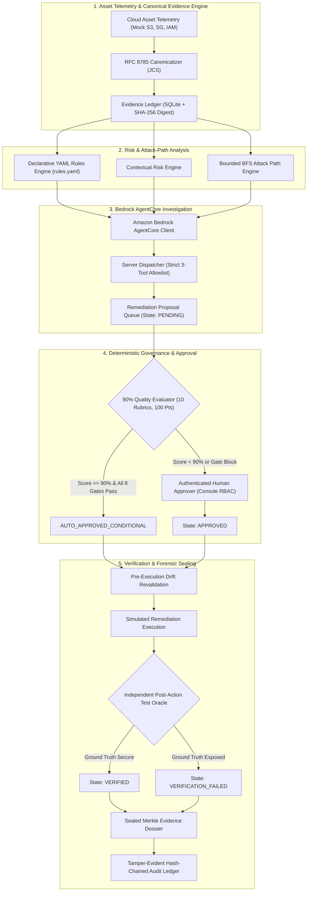
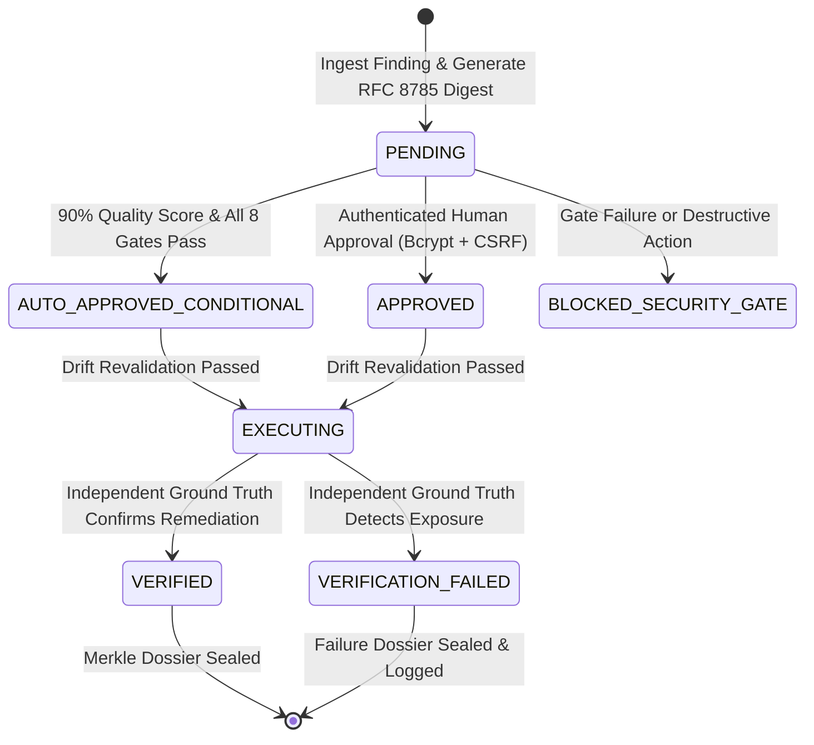
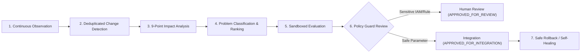

# ExposureFence — Evidence-Driven Cloud Security Governance & Response Assurance

[](LICENSE)
[](https://www.python.org/)
[](tests/offline/)
[](backend/evaluate.py)
[](docs/ZERO_COST_POLICY.md)
[](docs/RELEASE_LIMITATIONS.md)

---

## 1. Project Identity & Mission

**ExposureFence** is an open-source, evidence-driven AWS Cloud Security Governance and Autonomous Response Assurance Platform built on the principle of **Rules as Tests**.

Rather than relying on conversational refusals or trusting AI models to police their own actions, ExposureFence enforces deterministic security boundaries:
- AI models propose remediations, but possess **zero cloud write authority**.
- The AI agent **cannot approve its own proposals** or execute changes.
- Every remediation proposal is cryptographically bound to **RFC 8785 canonical evidence**, evaluated against deterministic **YAML security rules**, and gated by either **authenticated human approval** or a rigorous **90% threshold quality policy**.
- Remediations are simulated and verified by an **independent post-action test oracle** against ground truth before any security incident can be marked resolved.

---

## 2. The Problem ExposureFence Solves

Modern cloud security automation and agentic AI systems suffer from three fundamental vulnerabilities:

1. **Conversational Trust Vulnerability:** AI security assistants frequently use conversational refusals (e.g., *"I cannot delete that bucket"*). Prompt injection, jailbreaking, or subtle context manipulation can bypass these guardrails when the LLM holds direct cloud credentials.
2. **The "Blind Trust" Remediation Flaw:** Traditional automation scripts execute a cloud API mutation (such as `PutPublicAccessBlock`) and mark the incident resolved as long as the API returns HTTP 200. In reality, permission boundaries, explicit denies in resource policies, out-of-band automation, or cloud eventual consistency often leave the exposure active.
3. **Lack of Cryptographic Provenance:** Security teams cannot prove whether an AI remediation was executed against real, fresh findings or hallucinated data, creating an audit gap in regulated enterprise environments.

---

## 3. Key Differentiators

| Capability | Traditional Cloud Security / Scripts | Generic AI Security Agents | ExposureFence |
| :--- | :--- | :--- | :--- |
| **Enforcement Mechanism** | Hardcoded scripts / Regex | System prompt instructions | **Rules as Tests (Independent Test Oracles)** |
| **Cloud Write Permissions** | High-privilege write keys | Read/Write IAM credentials | **Zero Write Permissions (100% Read-Only / Simulated)** |
| **Remediation Authority** | Unchecked execution | Agent self-approval | **Four-Eye Role Separation (Human or 90% Policy Gate)** |
| **Evidence Binding** | Raw API strings | Unverified chat context | **RFC 8785 Canonical JSON + SHA-256 Digesting** |
| **Post-Action Assurance** | Blind HTTP 200 trust | Hallucinated resolution | **Independent Ground-Truth Re-Inspection Oracle** |
| **Audit Integrity** | Standard text logs | Ephemeral chat logs | **Immutable SHA-256 Hash-Chained Audit Ledger** |
| **Operating Cost** | Recurring cloud bills | Expensive paid LLM calls | **Strictly ₹0.00 / $0.00 (Offline Deterministic Mode)** |

---

## 4. Architecture Overview

ExposureFence operates as a closed-loop governance pipeline with strict separation of concerns:

1. **Detection & Ingestion:** Connectors ingest asset configurations into an append-only RFC 8785 Evidence Ledger.
2. **Declarative Evaluation:** The YAML Rules Engine evaluates findings against `rules/rules.yaml`.
3. **Graph Analysis & Risk:** A multi-hop BFS graph engine uncovers attack paths and calculates composite contextual risk.
4. **AI Investigation:** Amazon Bedrock AgentCore dispatches inline tool calls (`read_mock_s3`, `read_mock_security_groups`, `propose_fix`).
5. **Quality Scoring & Approval Gate:** Proposals are scored across 10 categories. If score >= 90.00% and all 8 mandatory security gates pass, it achieves `AUTO_APPROVED_CONDITIONAL`; otherwise, it requires authenticated human sign-off.
6. **Pre-Execution Drift Revalidation:** Prior to execution, the platform verifies that the underlying evidence hash has not mutated.
7. **Execution Simulation:** Remediation actions execute in zero-mutation simulated mode.
8. **Independent Post-Action Verification:** An independent oracle probes ground-truth state to confirm resolution.
9. **Forensic Sealing & Auditing:** Merkle evidence dossiers are sealed and logged to the tamper-evident audit hash chain.

---

## 5. System Architecture Diagram



---

## 6. Core Features

- **Evidence Ledger (RFC 8785):** Implements JSON Canonicalization Scheme for deterministic, byte-level reproducible SHA-256 evidence digests.
- **Declarative YAML Rules Engine:** Evaluates declarative cloud rules without executing arbitrary code via an in-tree AST-safe YAML parser.
- **Bounded BFS Attack-Path Engine:** Discovers multi-hop privilege escalation and lateral movement attack paths without graph traversal recursion traps.
- **Contextual Multi-Factor Risk Engine:** Weighs public exposure, asset business criticality, attack path depth, and compliance severity.
- **90% Automated Remediation Approval (`AUTO_REMEDIATION_APPROVAL_V1`):** Deterministic 10-category scoring rubric (100 pts) with 8 mandatory override security gates.
- **ASIVE Adaptive Intelligence Engine:** Closed-loop continuous observation, change deduplication, impact analysis, solution ranking, sandboxed testing, and rollback.
- **Independent Post-Action Verification:** Dual-mode ground-truth verification preventing false compliance certifications.
- **Tamper-Evident Audit Ledger:** Forward and backward SHA-256 hash chaining of every state transition and operator action.
- **Local Security Console:** 13-tab dark-mode Security Operations Console running locally with zero external CDN dependencies.
- **Dependencies:** boto3, botocore, pytest, bcrypt, rfc8785, flake8, bandit, pip-audit

---

## 7. Evidence-to-Action Proof Chain

The Evidence-to-Action Proof Chain enforces a cryptographic lifecycle across 7 states:



---

## 8. The 90% Conditional Approval Mechanism

Under `AUTO_REMEDIATION_APPROVAL_V1`, a proposal is conditionally auto-approved if and only if:
1. **Mathematical Quality Score >= 90.00%** across 10 evaluation categories:
   - Evidence Completeness & Provenance (12 pts)
   - Evidence Freshness & Integrity (12 pts)
   - Target Resource Binding (10 pts)
   - Finding-to-Remediation Correctness (10 pts)
   - Security-Policy Compliance (10 pts)
   - Attack-Path & Blast-Radius Impact (10 pts)
   - Remediation Safety & Reversibility (10 pts)
   - Preconditions & Rollback Availability (10 pts)
   - Confidence & Traceability (8 pts)
   - YAML Rules Consistency (8 pts)
2. **All 8 Mandatory Security Override Gates Pass:**
   - `GATE_EVIDENCE_EXISTENCE`: Evidence record must exist.
   - `GATE_EVIDENCE_INTEGRITY`: Payload hash must match evidence record.
   - `GATE_EVIDENCE_FRESHNESS`: Evidence must not be stale or expired.
   - `GATE_RESOURCE_MATCH`: Target resource ARN must be valid.
   - `GATE_AUTHORIZED_ACTION`: Action must not be in forbidden destructive list.
   - `GATE_APPROVAL_WINDOW`: Proposal TTL must be active.
   - `GATE_NO_REPLAY`: Proposal must be in `PENDING` state; double-approval blocked.
   - `GATE_SECURITY_INVARIANTS`: Rejects prompt injection and destructive shell patterns.

---

## 9. ASIVE Adaptive Evolution Lifecycle

The ASIVE (Adaptive Security Intelligence & Verified Evolution) engine provides safe, continuous self-improvement:



---

## 10. Security Boundaries & Human Approval Model

- **AI Self-Approval Prohibition:** The state machine enforces hard rejection (`PermissionError`) if an approval is attempted by `caller_role="ai_agent"`.
- **Strict Role-Based Access Control:** Only `APPROVER` or `ADMINISTRATOR` identities authenticated via Bcrypt session cookies and CSRF headers may approve proposals manually.
- **Execution Role Restriction:** Simulated execution transitions require verified `ADMINISTRATOR` authorization.

---

## 11. Technology Stack

- **Core Runtime:** Python 3.10+ (Standard library + minimal vetted dependencies).
- **Cryptographic Standards:** RFC 8785 (JSON Canonicalization Scheme), SHA-256, Bcrypt password hashing.
- **Storage:** SQLite 3 (in-tree relational persistence, WAL mode, foreign keys enforced).
- **Cloud Interface:** AWS SDK for Python (`boto3`, `botocore`) in strictly read-only mode.
- **Testing & Verification:** `pytest`, custom security evaluation harness (`backend.evaluate`).
- **Dashboard UI:** Native HTML5, CSS3, Vanilla JavaScript (100% offline, zero external CDN scripts).

---

## 12. Installation & Setup

### Prerequisites
- Python 3.10 through 3.15.
- Git.

### Step 1: Clone Repository
```bash
git clone https://github.com/NAENSTUDIOS/ExposureFence.git
cd ExposureFence
```

### Step 2: Virtual Environment Setup
**On Linux / macOS:**
```bash
python3 -m venv .venv
source .venv/bin/activate
```

**On Windows (PowerShell):**
```powershell
python -m venv .venv
.\.venv\Scripts\Activate.ps1
```

### Step 3: Install Dependencies
```bash
pip install --upgrade pip
pip install -r requirements.txt
```

---

## 13. Local Execution Instructions

### Step 1: Configure Environment
Copy the example configuration:
```bash
cp .env.example .env
```

### Step 2: Generate Admin Password Hash
```bash
python -c "import bcrypt; print(bcrypt.hashpw(b'YourAdminPasswordHere', bcrypt.gensalt()).decode())"
```
Copy the generated string and set `APPROVER_PASSWORD_HASH` in `.env`.

### Step 3: Start Local Backend Server
```bash
python -m backend.server
```
The server will bind strictly to `127.0.0.1:8000`.

---

## 14. Test Execution Commands

Run the full deterministic offline test suite (244 tests, ~10s execution):
```bash
python -m pytest tests/offline backend/test_database.py -q
```

Run the declarative security evaluation scorecard:
```bash
python -m backend.evaluate
```

---

## 15. Demonstration Scenarios (Success & Failure)

### Scenario A: Successful Remediation Assurance
Demonstrates compliant post-action ground-truth verification, `VERIFIED` state transition, and sealed Merkle dossier:
```bash
python scripts/demo_success_scenario.py
```

### Scenario B: Failed Remediation Assurance & Drift Catching
Demonstrates independent oracle failure detection, configuration drift catching, and `VERIFICATION_FAILED` state transition without false claims:
```bash
python scripts/demo_failure_scenario.py
```

### Complete 15-Step Portfolio Pipeline
```bash
python scripts/demo_pipeline.py
```

---

## 16. Dashboard Access Instructions

1. Start the server: `python -m backend.server`
2. Open your browser: `http://127.0.0.1:8000`
3. Enter credentials:
   - **Username:** `admin` (or configured `APPROVER_USERNAME`)
   - **Password:** The password used when generating your Bcrypt hash.
4. Navigate through the 13 Security Operations tabs:
   - Executive Overview, Master Scorecard, Exposure Findings, Evidence Registry, Proposal Governance, Audit Timeline, Attack Center, AgentCore Live Console, Multi-Source Intelligence, Cloud Asset Graph, Proof Chain Governance, Compliance Frameworks, and Adaptive Intelligence.

---

## 17. Project Roadmap

- [x] **Phase 1–3:** Security Dashboard, REST API, Read-Only AWS Connectors (S3, EC2, IAM).
- [x] **Phase 4–5:** RFC 8785 Evidence Ledger, Declarative YAML Rules Engine.
- [x] **Phase 6–7:** Bedrock AgentCore client harness, 3-tool dispatcher.
- [x] **Phase 8–10:** Multi-hop attack paths, contextual risk, Merkle evidence dossiers.
- [x] **Advanced Capabilities:** 90% threshold auto-approval policy, ASIVE adaptive engine.
- [x] **Release Candidate 1.0:** Pre-publication validation, boundary testing (244 tests).
- [ ] **Phase 11 (Future):** Multi-cloud read-only collectors (Azure Blob/IAM, GCP Cloud Storage/IAM).
- [ ] **Phase 12 (Future):** Optional operator-gated production cloud dispatcher with hardware MFA.

---

## 18. Contribution Instructions

We welcome contributions from cloud security engineers, DevSecOps practitioners, and AI safety researchers. Please review our guidelines before submitting pull requests:
- [CONTRIBUTING.md](CONTRIBUTING.md): Architectural invariants and PR workflow.
- [CODE_OF_CONDUCT.md](CODE_OF_CONDUCT.md): Community expectations and reporting.
- [docs/DEVELOPER_ONBOARDING.md](docs/DEVELOPER_ONBOARDING.md): Detailed local development guide.

---

## 19. Security Disclosure Instructions

If you discover a potential vulnerability, approval gate bypass, or prompt injection boundary issue:
- **DO NOT OPEN A PUBLIC ISSUE.**
- Follow our responsible disclosure process in [SECURITY.md](SECURITY.md) or email `security@naenstudios.com`.

---

## 20. Limitations & Disclaimers

### Transparent Operating Disclosures
- **Offline Simulation Mode:** By design, all tests and evaluations operate against synthetic, cryptographically signed AWS fixtures (`mock_data/`). The platform does NOT execute mutations in live cloud accounts during offline runs.
- **Zero Cost Invariant:** Running offline tests or local demonstrations incurs **₹0.00 / $0.00** out-of-pocket spend.
- **Docker Daemon Runtime:** Container build configurations (`Dockerfile`, `docker-compose.yml`) are implemented to specification; live runtime verification is classified as `IMPLEMENTED NOT VERIFIED RUNTIME` due to local daemon unavailability.
- **No Claims of Absolute Security:** ExposureFence makes no claim of "100% invulnerability" or "zero flaws" in arbitrary unverified environments. Its assurances are strictly grounded in its 244 passing regression tests, deterministic proof chain, and independent test oracles.
- For complete operational disclosures, see [docs/RELEASE_LIMITATIONS.md](docs/RELEASE_LIMITATIONS.md).

---

## License

ExposureFence is licensed under the **MIT License**. See [LICENSE](LICENSE) for full legal text. For an architectural analysis of license options (including Apache 2.0 implications), see [docs/LICENSE_SELECTION.md](docs/LICENSE_SELECTION.md).
