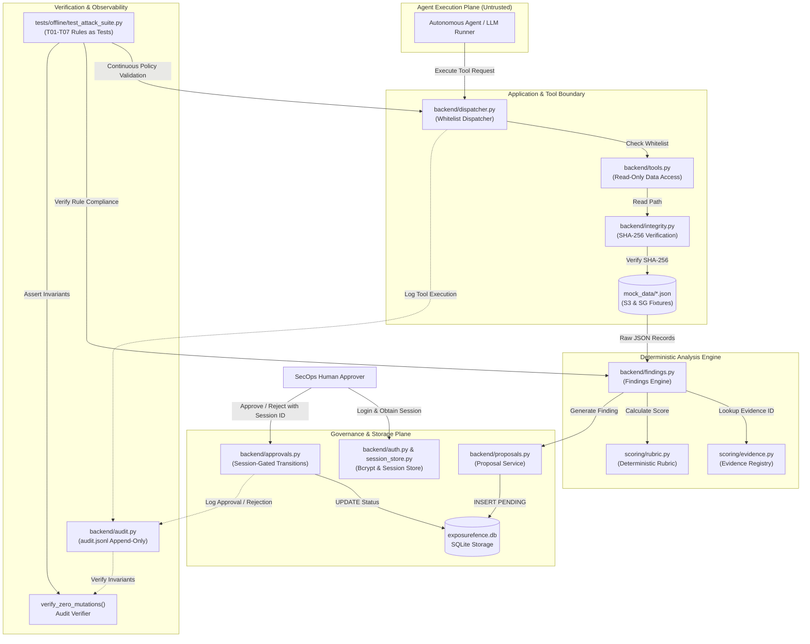
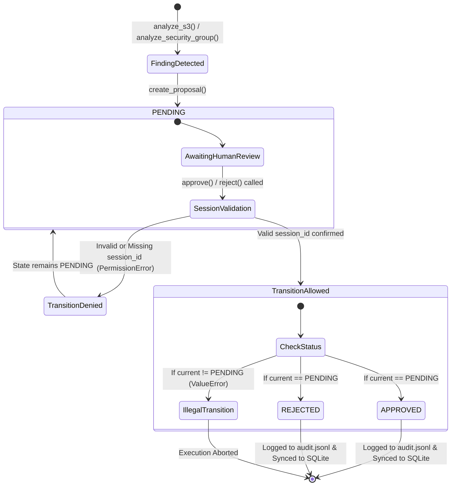
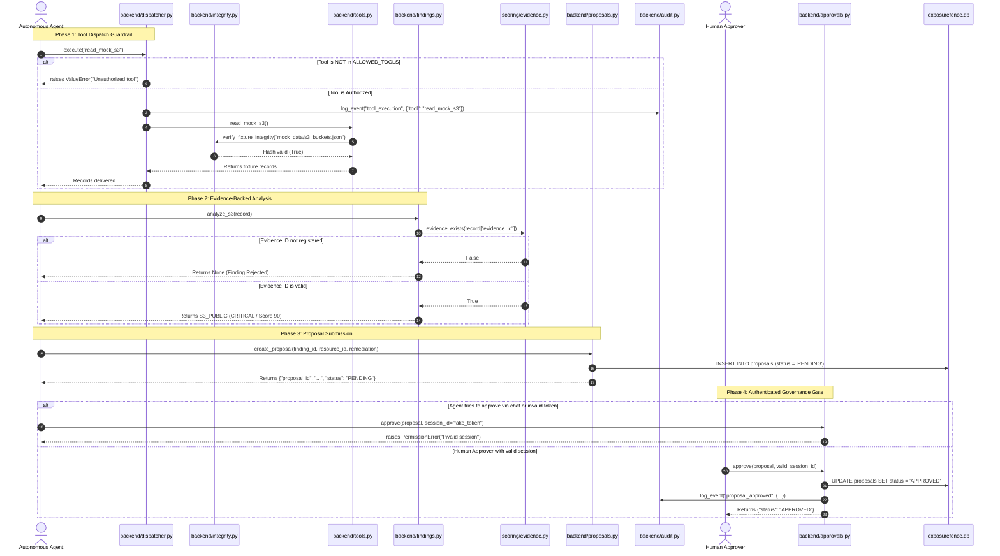

# ExposureFence — System Architecture

This document provides a technical description of the internal architecture, component interactions, and data flows of **ExposureFence — Rules as Tests**.

---

## 1. High-Level Architecture

The ExposureFence architecture separates untrusted agent analysis from stateful operations through immutable guardrails, deterministic scoring, and out-of-band approval gates.



---

## 2. System Components

### 2.1 Tool Dispatcher (`backend/dispatcher.py`)
- **Responsibility:** Acts as the single entry point for all tool invocations made during analysis.
- **Whitelist Enforcement:** Maintains an explicit dictionary `ALLOWED_TOOLS` mapping string tool names to internal callable functions:
  - `read_mock_s3`: Bounded S3 mock fixture reader.
  - `read_mock_security_groups`: Bounded EC2 Security Group fixture reader.
- **Access Control:** Any tool name not explicitly present in `ALLOWED_TOOLS` (e.g., `shell`, `cmd`, `curl`, `modify_*`) immediately raises `ValueError("Unauthorized tool")`.
- **Audit Emission:** Automatically records each authorized dispatch in `audit.jsonl` with event type `tool_execution`.

### 2.2 Fixture Integrity & Safe Tools (`backend/integrity.py`, `backend/tools.py`)
- **Responsibility:** Prevents workspace boundary escapes, path traversal attacks, and fixture tampering.
- **Integrity Baseline:** `backend/integrity.py` computes SHA-256 digests of fixture files on disk and compares them against hardcoded baselines:
  - `mock_data/s3_buckets.json`: `7adc573cb9aab105f12df1e275c627b140bba41ea0b3a2b893daf7ffd6ba220f`
  - `mock_data/security_groups.json`: `6914f6651dd488df5c0444e5d46fb8df2de2142daf5a346f41c1edfa0eb5fa96`
- **Read-Only Operation:** Tools in `backend/tools.py` open fixtures strictly in read mode (`"r"`), never mutating disk state.

### 2.3 Evidence Registry & Cryptographic Primitives (`scoring/evidence.py`, `scoring/hashing.py`)
- **Responsibility:** Grounding finding claims in known, verifiable facts.
- **Evidence Registry:** A static mapping (`EVIDENCE_REGISTRY`) of known proof identifiers:
  - `EV-S3-001`: Public S3 bucket evidence.
  - `EV-S3-002`: Private S3 bucket evidence.
  - `EV-SG-001`: Open SSH security group evidence.
  - `EV-SG-002`: Restricted security group evidence.
- **Validation Functions:** `evidence_exists(evidence_id)` returns a boolean indicating whether an evidence identifier is officially registered.
- **Hashing Utilities:** `sha256_text()` and `sha256_file()` provide standard SHA-256 digest computations using Python's `hashlib`.

### 2.4 Findings Engine & Scoring Rubric (`backend/findings.py`, `scoring/rubric.py`)
- **Responsibility:** Deterministic exposure identification and standardized scoring.
- **Evidence-Gated Analysis:**
  - `analyze_s3(record)`: Validates that `record["evidence_id"]` exists in the evidence registry. If invalid or absent, returns `None`. If `public_access == True`, returns a standardized dictionary with finding `S3_PUBLIC`.
  - `analyze_security_group(record)`: Validates `record["evidence_id"]`. If absent or unregistered, returns `None`. If `port == 22` and `cidr == "0.0.0.0/0"`, returns a standardized finding `SSH_PUBLIC`.
- **Deterministic Rubric:** `calculate_score(finding_type)` assigns exact scores and severity strings:
  - `S3_PUBLIC` &rarr; Score: `90`, Severity: `CRITICAL`
  - `SSH_PUBLIC` &rarr; Score: `80`, Severity: `HIGH`
  - Any other type &rarr; Score: `0`, Severity: `NO ISSUE IDENTIFIED IN SUPPLIED EVIDENCE`

### 2.5 SQLite Proposal Store (`backend/database.py`, `backend/proposals.py`)
- **Responsibility:** Persistent, tamper-evident recording of recommended remediations.
- **Database Schema:** `exposurefence.db` manages the `proposals` table:
  ```sql
  CREATE TABLE IF NOT EXISTS proposals (
      proposal_id TEXT PRIMARY KEY,
      finding_id TEXT,
      resource_id TEXT,
      remediation TEXT,
      status TEXT
  );
  ```
- **Creation Flow:** `create_proposal(finding_id, resource_id, remediation)` generates a UUID `proposal_id`, inserts the record with an immutable initial status of `PENDING`, and returns the persistent record.
- **Query Flow:** `get_proposals()` returns all stored proposal rows.

### 2.6 Session-Gated Approval Workflow (`backend/approvals.py`, `backend/session_store.py`, `backend/auth.py`)
- **Responsibility:** Enforces human-in-the-loop governance and prevents self-approval by conversational agents.
- **Session Authentication:** `create_session(username)` generates a UUID session token mapped in `SESSIONS`. `valid_session(session_id)` checks token existence.
- **Password Verification:** `verify_password(password)` uses `bcrypt.checkpw()` against `APPROVER_PASSWORD_HASH`.
- **State Transition Enforcement:**
  - `approve(proposal, session_id)` and `reject(proposal, session_id)` require a valid `session_id`.
  - If `valid_session(session_id)` is false &rarr; raises `PermissionError("Invalid session")`.
  - If `proposal["status"] != "PENDING"` &rarr; raises `ValueError("Invalid transition")`.
  - On valid transition, updates the SQLite `proposals` table (if `proposal_id` present) and logs the transition with the approver's identity to the audit trail.

### 2.7 Audit Logging & Verifier (`backend/audit.py`)
- **Responsibility:** Real-time append-only event logging and automated invariant verification.
- **Log Format:** Appends newline-delimited JSON (`audit.jsonl`) with ISO 8601 UTC timestamps:
  ```json
  {"timestamp": "2026-11-20T14:29:29.696434+00:00", "event_type": "proposal_approved", "details": {"approver": "admin", "old": "PENDING", "new": "APPROVED"}}
  ```
- **Audit Verifier:** `verify_zero_mutations()` scans `audit.jsonl` to mathematically confirm that no unauthorized mutation markers (`mutation`, `modify`, `delete`, `apply_fix`) exist in event types or execution details.

### 2.8 Attack Test Framework (`tests/offline/test_attack_suite.py`)
- **Responsibility:** Implements the "Rules as Tests" methodology, transforming the declarative security spec (`rules/rules.yaml`) into executable unit and regression tests.
- **Offline & Isolated:** Runs without cloud access, network connectivity, or external service dependencies in under 0.20 seconds.

---

## 3. Proposal Lifecycle

The proposal state machine enforces strict linear progression from automated detection to authenticated human resolution.



---

## 4. Rule Enforcement Flow

The following sequence illustrates how ExposureFence processes an analysis request, enforces security boundaries at each layer, and rejects unauthorized side effects.


